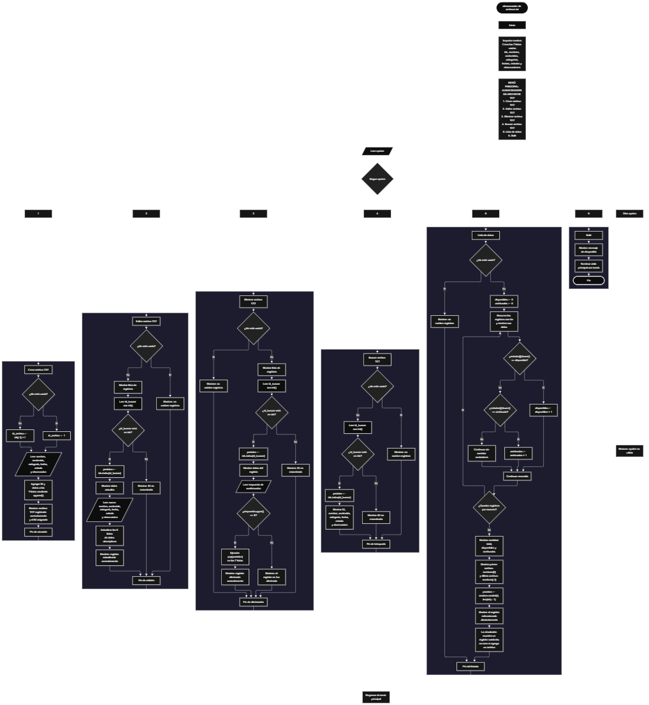

 

Este proyecto, llamado <b>almacenador de archivos txt</b>, fue desarrollado en <b>python</b> como un ejercicio práctico para fortalecer la lógica de programación mediante la creación de un sistema de gestión de registros desde la consola. El programa cuenta con un menú principal de seis opciones que permite <b>crear, editar, eliminar, buscar y listar registros de archivos txt</b>, además de finalizar la ejecución. Cada registro almacena datos como el nombre del archivo, su contenido, la categoría, la fecha de creación, el estado y una observación, utilizando siete listas paralelas que mantienen la información relacionada mediante un identificador único dentro de los registros actuales. Durante su desarrollo se aplicaron conceptos fundamentales de programación, como variables, listas, estructuras condicionales, ciclos repetitivos, búsqueda por identificador, modificación y eliminación de registros, así como el uso del módulo <b>random</b> para seleccionar un registro aleatorio. Este proyecto permite poner en práctica los conocimientos adquiridos en python y sirve como base para desarrollar sistemas de almacenamiento y gestión de información más avanzados.

<h2 align="center">⚙️ Funcionamiento del menú principal</h2>

### ➕ Crear archivo TXT

La opción <b>1) crear archivo txt</b> permite registrar un nuevo elemento en el sistema. Antes de realizar el registro, el programa comprueba si la lista <b>ids</b> está vacía mediante la condición <b>len(ids) == 0</b>. Si no existen registros, asigna el identificador <b>1</b> al primer elemento. En caso contrario, calcula el siguiente identificador sumando uno al último ID almacenado mediante la expresión <b>ids[-1] + 1</b>. Después, solicita el <b>nombre del archivo txt, contenido, categoría, fecha de creación, estado y observación</b>. Los datos se incorporan a sus respectivas listas mediante el método <b>append()</b>, manteniendo la misma posición para la información correspondiente a cada registro. Finalmente, muestra el mensaje <b>"archivo txt registrado correctamente."</b> e indica el identificador asignado. Esta operación almacena la información en las listas durante la ejecución del programa, pero no crea un archivo txt físico en el sistema de archivos.

### ✏️ Editar archivo TXT

La opción <b>2) editar archivo txt</b> permite modificar los datos de un registro existente. Primero, el programa comprueba si la lista <b>ids</b> está vacía. Si no hay registros, muestra el mensaje <b>"no existen registros."</b>. En caso contrario, utiliza un ciclo <b>for</b> para recorrer las listas y presentar los datos de todos los registros. Después, solicita el identificador mediante la variable <b>id_buscar</b>, convirtiendo la entrada a un número entero con la función <b>int()</b>. Si el identificador se encuentra en la lista <b>ids</b>, obtiene su posición mediante el método <b>ids.index(id_buscar)</b> y muestra los datos actuales. A continuación, solicita el nuevo nombre, contenido, categoría, fecha de creación, estado y observación, actualizando los valores de las seis listas descriptivas sin modificar el identificador. Finalmente, presenta el mensaje <b>"registro actualizado correctamente."</b>. Si el ID no existe, muestra el mensaje <b>"id no encontrada."</b>.

### 🗑️ Eliminar archivo TXT

La opción <b>3) eliminar archivo txt</b> permite eliminar un registro del sistema mediante su identificador. Antes de comenzar, el programa comprueba si existen registros almacenados. Si la lista <b>ids</b> está vacía, muestra el mensaje <b>"no existen registros."</b>. Si hay elementos disponibles, recorre las listas y presenta la información de cada registro. Después, solicita el ID que se desea eliminar y comprueba si está presente en la lista <b>ids</b>. Cuando encuentra una coincidencia, obtiene la posición correspondiente con <b>ids.index(id_buscar)</b> y muestra los datos del registro seleccionado. A continuación, solicita confirmación mediante la pregunta <b>"¿desea eliminar este registro? (s/n):"</b>. Si la respuesta convertida a mayúsculas mediante <b>respuesta.upper()</b> es igual a <b>"S"</b>, utiliza el método <b>pop(posicion)</b> para eliminar la misma posición de las siete listas: <b>ids, nombres, contenidos, categorias, fechas, estados y observaciones</b>. Finalmente, muestra el mensaje <b>"registro eliminado correctamente."</b>. Si el usuario no confirma la eliminación, presenta el mensaje <b>"el registro no fue eliminado."</b>. Cuando el ID no existe, muestra <b>"id no encontrada."</b>.

### 🔎 Buscar archivo TXT

La opción <b>4) buscar archivo txt</b> permite localizar un registro mediante su identificador. Primero, el programa comprueba si existen registros almacenados en la lista <b>ids</b>. Si no hay elementos, presenta el mensaje <b>"no existen registros."</b>. En caso contrario, solicita el identificador que se desea buscar y convierte la entrada a un número entero utilizando <b>int()</b>. Después, comprueba si el ID introducido se encuentra en la lista mediante la condición <b>id_buscar in ids</b>. Si existe una coincidencia, utiliza <b>ids.index(id_buscar)</b> para obtener la posición del registro y muestra todos sus datos: identificador, nombre, contenido, categoría, fecha de creación, estado y observación. Si no encuentra el identificador solicitado, presenta el mensaje <b>"id no encontrada."</b>. Esta operación permite consultar individualmente un registro sin modificar sus datos.

### 📋 Lista de datos

La opción <b>5) lista de datos</b> permite visualizar los registros almacenados y consultar estadísticas generales del sistema. Antes de comenzar, el programa comprueba si la lista <b>ids</b> está vacía. Si no existen registros, muestra el mensaje <b>"no existen registros."</b>. En caso contrario, inicializa los contadores <b>disponibles</b> y <b>archivados</b> con el valor <b>0</b>. Después, utiliza un ciclo <b>for</b> para recorrer las listas y mostrar los datos de cada elemento. Durante el recorrido, compara el estado de cada registro mediante <b>estados[i].lower()</b>. Si el resultado es igual a <b>"disponible"</b>, aumenta el contador de archivos disponibles; si es igual a <b>"archivado"</b>, incrementa el contador de archivos archivados. Al finalizar, muestra la cantidad total de archivos, los archivos disponibles y archivados, el primer nombre registrado mediante <b>nombres[0]</b> y el último mediante <b>nombres[-1]</b>. Posteriormente, utiliza <b>random.randint(0, len(ids) - 1)</b> para seleccionar una posición aleatoria y mostrar los datos del registro correspondiente. Esta última operación constituye una simulación de almacenamiento: presenta un registro existente, pero no agrega un elemento nuevo ni crea un archivo físico.

### 🚪 Salir del menú principal

La opción <b>6) salir</b> permite finalizar la ejecución del programa. Cuando el usuario selecciona esta opción, se muestra el mensaje <b>"gracias por utilizar el almacenador de archivos txt."</b> y se ejecuta la instrucción <b>break</b>, que termina el ciclo principal <b>while True</b>. De esta manera, el programa deja de mostrar el menú y finaliza su ejecución. Debido a que los registros se encuentran almacenados únicamente en listas dentro de la memoria, los datos dejan de estar disponibles cuando termina el programa.

<h2 align="center">🧠 Temas aplicados en el proyecto</h2>

### 📦 Variables

En este proyecto se utilizan variables para almacenar los datos introducidos por el usuario, controlar los identificadores, seleccionar los registros que se desean editar, eliminar o buscar, gestionar las estadísticas y determinar la posición del elemento seleccionado aleatoriamente. Cada variable cumple una función específica dentro de las operaciones del menú principal.

🔢 **Opcion:** Almacena la opción seleccionada por el usuario en el menú principal.

🆔 **Id_archivo:** Guarda el identificador asignado al nuevo registro durante su creación.

🔎 **Id_buscar:** Almacena el identificador introducido por el usuario para localizar el registro que desea consultar, editar o eliminar.

📍 **Posicion:** Guarda el índice correspondiente al registro encontrado mediante el método `ids.index(id_buscar)`.

📝 **Nombre:** Almacena el nombre del archivo txt que se registra o modifica.

📄 **Contenido:** Guarda el contenido textual asociado al registro.

🗂️ **Categoria:** Almacena la categoría asignada al archivo.

📅 **Fecha:** Guarda la fecha de creación introducida por el usuario.

📌 **Estado:** Almacena el estado indicado para el registro, como disponible o archivado.

💬 **Observacion:** Guarda información adicional relacionada con el archivo.

🔢 **Disponibles:** Cuenta los registros cuyo estado es disponible.

📦 **Archivados:** Cuenta los registros cuyo estado es archivado.

🎲 **Posicion:** También se utiliza en la opción de listado para guardar la posición seleccionada aleatoriamente. Su valor cambia según la operación en la que se utiliza.

### 🗃️ Listas paralelas

El proyecto utiliza siete listas paralelas para almacenar la información de los registros. Todas mantienen una relación por posición: el elemento situado en el índice <b>i</b> de una lista corresponde al mismo registro que ocupa el índice <b>i</b> en las demás. Por ejemplo, los datos de un archivo almacenado en la posición <b>0</b> se encuentran distribuidos entre <b>ids[0], nombres[0], contenidos[0], categorias[0], fechas[0], estados[0]</b> y <b>observaciones[0]</b>. Esta organización permite gestionar los datos de manera coordinada durante las operaciones de creación, edición, eliminación, búsqueda y listado.

🆔 **Ids:** Almacena los identificadores de los registros.

📝 **Nombres:** Guarda los nombres de los archivos txt.

📄 **Contenidos:** Almacena el contenido de cada registro.

🗂️ **Categorias:** Guarda las categorías asignadas.

📅 **Fechas:** Almacena las fechas de creación.

📌 **Estados:** Registra el estado de cada elemento.

💬 **Observaciones:** Guarda las observaciones adicionales.

### 🔀 Estructuras condicionales

En este proyecto se utilizan las estructuras <b>if, elif y else</b> para controlar las opciones del menú y determinar qué operación debe ejecutarse. También permiten comprobar si existen registros, verificar si un identificador se encuentra en la lista <b>ids</b>, decidir si se confirma una eliminación y clasificar los registros según su estado. Estas condiciones permiten que el programa responda de forma diferente dependiendo de la información almacenada y de las entradas proporcionadas por el usuario.

### 🔄 Estructuras repetitivas

El programa utiliza el ciclo <b>while True</b> para mantener activo el menú principal hasta que el usuario selecciona la opción de salida. Dentro de las operaciones de edición, eliminación y listado, utiliza el ciclo <b>for</b> con la expresión <b>range(len(ids))</b> para recorrer los registros almacenados. Estos ciclos permiten mostrar los datos de todos los elementos, contar los estados correspondientes y facilitar la selección de registros mediante su posición.

### 🔎 Búsqueda por identificador

La búsqueda de registros se realiza utilizando la lista <b>ids</b> y los métodos de pertenencia e índice de Python. La expresión <b>id_buscar in ids</b> permite comprobar si existe el identificador solicitado, mientras que <b>ids.index(id_buscar)</b> obtiene la posición en la que se encuentra. Esa posición se utiliza después para consultar o actualizar los datos correspondientes en las listas paralelas. El mismo procedimiento se emplea en las operaciones de edición, eliminación y búsqueda.

### 🧰 Métodos y funciones de Python

Durante el desarrollo se aplican distintos métodos y funciones integrados de Python para administrar los registros. El método <b>append()</b> agrega información al final de las listas; <b>index()</b> permite localizar la posición de un identificador; <b>pop()</b> elimina un elemento de una posición específica; <b>len()</b> devuelve la cantidad de elementos almacenados; <b>int()</b> convierte la entrada del identificador a un número entero; y <b>lower()</b> y <b>upper()</b> convierten cadenas a minúsculas y mayúsculas para facilitar determinadas comparaciones. Además, <b>random.randint()</b> permite seleccionar una posición aleatoria dentro del rango de índices disponibles.

### 📊 Contadores y estadísticas

La opción de listado utiliza las variables <b>disponibles</b> y <b>archivados</b> como contadores. Ambas comienzan en cero y aumentan durante el recorrido de los registros cuando el estado coincide con los valores esperados. El programa también utiliza <b>len(ids)</b> para determinar la cantidad total de archivos registrados y consulta las posiciones <b>nombres[0]</b> y <b>nombres[-1]</b> para mostrar el primer y el último nombre almacenado. Estas operaciones permiten obtener un resumen de los datos existentes.

### 🎲 Selección aleatoria

El módulo <b>random</b> se utiliza en la opción <b>5) lista de datos</b> para seleccionar un registro aleatorio. Mediante la instrucción <b>random.randint(0, len(ids) - 1)</b>, el programa genera un índice comprendido entre la primera y la última posición válida de las listas. El índice obtenido se utiliza para mostrar los datos de un registro existente. Esta funcionalidad sirve como simulación de almacenamiento, pero no realiza operaciones de escritura ni crea un archivo txt físico.

<h2 align="center">¿Cómo se implementaron las operaciones CRUD en el proyecto?</h2>

Las operaciones <b>crud</b> se implementaron mediante las opciones del menú principal para administrar los registros almacenados en las listas. La operación <b>crear</b> corresponde a <b>crear archivo txt</b>, donde se solicita la información de un nuevo registro y se agrega a las siete listas mediante <b>append()</b>. La operación <b>leer</b> se realiza mediante <b>buscar archivo txt</b> y <b>lista de datos</b>, que permiten consultar un registro individual o visualizar todos los registros y sus estadísticas. La operación <b>actualizar</b> corresponde a <b>editar archivo txt</b>, donde se modifican los campos descriptivos del registro seleccionado sin cambiar su identificador. Finalmente, la operación <b>eliminar</b> se implementa mediante <b>eliminar archivo txt</b>, que solicita confirmación y elimina la misma posición de todas las listas con <b>pop()</b>. Estas operaciones permiten administrar registros durante la ejecución, aunque los datos no se guardan permanentemente ni se crean archivos físicos.

<h2 align="center">Diagrama de flujo del proyecto</h2>

El siguiente diagrama de flujo representa la estructura del menú principal y las operaciones implementadas en el almacenador de archivos txt. Muestra los procesos de creación, edición, eliminación, búsqueda y listado de datos, además de las decisiones utilizadas para comprobar la existencia de registros y seleccionar las operaciones correspondientes. También representa el retorno al menú principal y la terminación del programa mediante la opción de salida.

<h2 align="center">🛡️ Validaciones y limitaciones del programa</h2>

### 📭 No existen registros

Esta comprobación se utiliza en las opciones de <b>editar, eliminar, buscar y lista de datos</b>. El programa verifica si la lista <b>ids</b> está vacía mediante la condición <b>len(ids) == 0</b>. Si no existen elementos almacenados, muestra el mensaje <b>"no existen registros."</b> y evita continuar con las operaciones que necesitan datos disponibles.

### 🔎 Identificador no encontrado

En las operaciones de edición, eliminación y búsqueda, el programa comprueba si el identificador introducido se encuentra en la lista <b>ids</b>. Si existe, obtiene su posición con <b>ids.index(id_buscar)</b> y accede a los datos relacionados. Si no se encuentra, presenta el mensaje <b>"id no encontrada."</b>. Esta comprobación permite informar al usuario cuando intenta trabajar con un registro que no está almacenado actualmente.

### 🗑️ Confirmación de eliminación

Antes de eliminar un registro, el programa solicita una respuesta mediante la pregunta <b>"¿desea eliminar este registro? (s/n):"</b>. La entrada se convierte a mayúsculas mediante <b>respuesta.upper()</b> y se compara con el valor <b>"S"</b>. Si coincide, se eliminan los datos correspondientes de las siete listas. Si no coincide, el registro se conserva y se muestra el mensaje <b>"el registro no fue eliminado."</b>. El programa no realiza una validación adicional para limitar la respuesta exclusivamente a las letras s y n.

### ⚠️ Entradas numéricas

Las operaciones que solicitan un identificador utilizan la función <b>int()</b> para convertir la entrada a un número entero. Si el usuario introduce texto que no puede convertirse a entero, Python puede generar una excepción y detener la ejecución de la operación. El código actual no incluye un bloque <b>try/except</b> para controlar ese caso. Por lo tanto, la entrada numérica debe ser válida para que la búsqueda, la edición o la eliminación continúen normalmente.

### 📌 Estados de los registros

Durante el listado, el programa reconoce los estados <b>"disponible"</b> y <b>"archivado"</b> mediante la conversión a minúsculas con <b>lower()</b>. Esta operación permite contar correctamente valores como <b>"DISPONIBLE"</b> o <b>"Archivado"</b>. Sin embargo, al registrar o editar un archivo no se comprueba que el estado introducido pertenezca a esas dos categorías. Si se utiliza otro valor, el registro se mostrará, pero no incrementará ninguno de los dos contadores de estados.

### 💾 Almacenamiento temporal

Los registros se almacenan en listas creadas en memoria al iniciar el programa. No se utiliza una base de datos, un archivo JSON, un archivo CSV ni un mecanismo de persistencia. Por esta razón, los datos no se conservan después de cerrar la aplicación. Aunque el programa se denomina <b>almacenador de archivos txt</b>, su implementación actual administra información sobre archivos mediante registros en listas, sin crear, leer ni modificar documentos txt físicos.

### 🆔 Identificadores de los registros

El identificador se asigna a partir del último elemento de la lista <b>ids</b>. Si la lista está vacía, se asigna el valor <b>1</b>; de lo contrario, se suma uno al último identificador almacenado. Debido a que el programa no mantiene un contador independiente ni calcula el identificador máximo existente, eliminar el registro que tenga el último ID puede ocasionar que ese identificador vuelva a utilizarse al crear otro registro. El código actual tampoco limita la cantidad de registros que pueden agregarse.

### 🎲 Simulación de almacenamiento

La opción de listado selecciona aleatoriamente un registro existente y muestra el mensaje <b>"archivo almacenado correctamente:"</b>. Sin embargo, esta acción es únicamente una simulación visual: el programa no agrega un nuevo registro a las listas ni escribe un documento txt en el sistema de archivos. El comportamiento real consiste en mostrar los datos de un elemento seleccionado al azar.

### ⚠️ Opción inválida

El menú principal utiliza una estructura condicional <b>if, elif y else</b> para identificar la opción seleccionada. Si el valor introducido no coincide con ninguna de las seis opciones disponibles, el programa muestra el mensaje <b>"opción no válida."</b> y vuelve a presentar el menú en la siguiente iteración del ciclo <b>while True</b>.

<h2 align="center">🎯 Objetivo del proyecto</h2>

El objetivo principal de este proyecto es fortalecer la <b>lógica de programación</b> mediante el desarrollo de un sistema de gestión de registros en <b>python</b>. A través de su construcción se busca aplicar conocimientos sobre variables, listas, estructuras condicionales, ciclos repetitivos, búsqueda por identificador, actualización y eliminación de datos. También se pretende comprender cómo organizar información relacionada mediante listas paralelas, obtener estadísticas básicas y utilizar el módulo <b>random</b> para seleccionar elementos de manera aleatoria. Este proyecto constituye una base práctica para desarrollar aplicaciones de gestión más completas que incorporen persistencia de datos y operaciones reales con archivos de texto.

